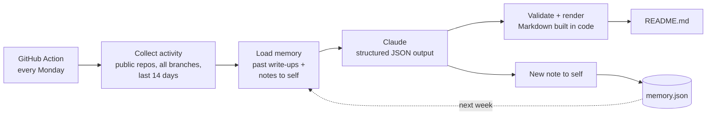

# README agent

The **What I'm building** section of my profile is written by an agent, not by me. Every Monday it reads my recent public GitHub activity, writes the section, and leaves itself a note on how to do better next week.



## How it works

1. **Collect.** [`update_readme.py`](update_readme.py) uses the GitHub REST API to find my public repos pushed in the last 14 days. It reads my commits on *every* branch (most of my work lives on `dev-*` branches) and a short excerpt of each README.
2. **Remember.** [`memory.json`](memory.json) holds the agent's last 8 write-ups and the note it left itself after each one. It goes into the prompt, so the agent can avoid repeating itself and apply its own feedback.
3. **Write.** Claude returns JSON in a fixed schema: a headline, up to three highlights (repo + summary) and a `note_to_future_self`.
4. **Guard.** The model never writes Markdown directly. Code drops highlights that don't name a repo from the activity, strips links, images and HTML, caps lengths, and renders the section itself. That way a bad generation can't put arbitrary content on my profile.
5. **Commit.** The workflow commits `README.md` and `memory.json` only if something changed.

## The feedback loop

The note to self is what makes this more than a cron job that summarizes commits. Each run, the agent compares its new write-up to earlier ones and writes down one or two things to do differently. The next run reads those notes as instructions. You can watch it evolve in [`memory.json`](memory.json)'s history.

## Run it yourself

```bash
pip install -r agent/requirements.txt
export GITHUB_TOKEN=...        # optional locally; avoids rate limits
python agent/update_readme.py --dry-run   # print the prompt, no API call
export ANTHROPIC_API_KEY=...
python agent/update_readme.py             # update README.md + memory.json
```

The workflow lives in [`.github/workflows/update-readme.yml`](../.github/workflows/update-readme.yml) and can also be started by hand from the Actions tab.
